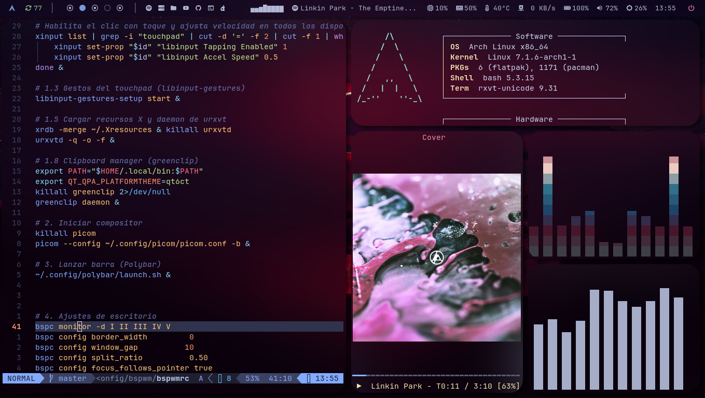

# my bspwm dotfiles

Configuración de mi escritorio **bspwm + polybar + sxhkd + rofi + picom**.
Respaldo Arch bspw.



## Requisitos (Arch Linux)

```bash
sudo pacman -S bspwm sxhkd polybar picom feh rofi xclip scrot \
    xss-lock i3lock playerctl brightnessctl greenclip \
    libinput-gestures xdotool jgmenu dunst
```

## Instalación

```bash
git clone https://github.com/jorgeTTPD/bspwm
cd bspwm
./install.sh
```

El instalador copia las carpetas (`bspwm/`, `polybar/`, `sxhkd/`, `picom/`,
`rofi/`, `scripts/`) a `~/.config/` y los dotfiles (`.Xresources`,
`.fehbg`, `greenclip.toml`, `libinput-gestures.conf`) a sus rutas.

Después configura tus wallpapers en `~/.fehbg` (usa `$HOME`) y reinicia:
`bspc restart`.

## Estructura

```
bspwm/        # bspwmrc y powermenu
polybar/      # barras (config.ini, config-soundbar.ini) y scripts
sxhkd/        # atajos de teclado
picom/        # compositor
rofi/         # menús y lanzadores
scripts/      # helpers: wallpaper, cheatsheet, screenshot, volumen…
.Xresources   # temas de terminal (urxvt)
.fehbg        # fondos de pantalla (plantilla con $HOME)
```

## Colores

Catppuccin Mocha:
- Fondo: `#1e1e2e`
- Texto: `#cdd6f4`
- Acento: `#89b4fa`
- Superficie: `#313244`
- Inactivo: `#6c7086`
